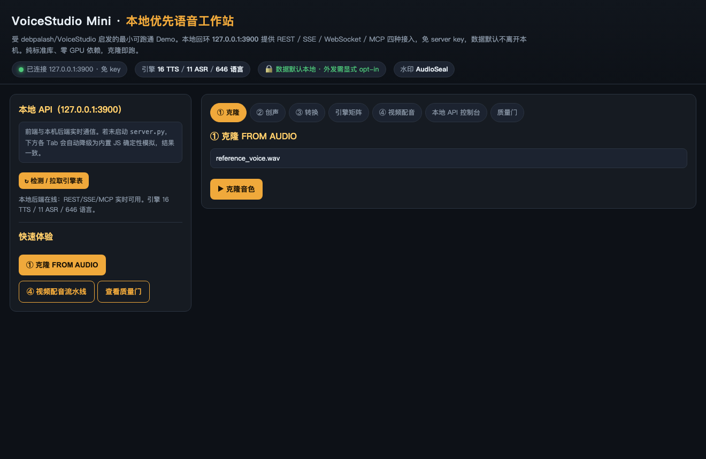
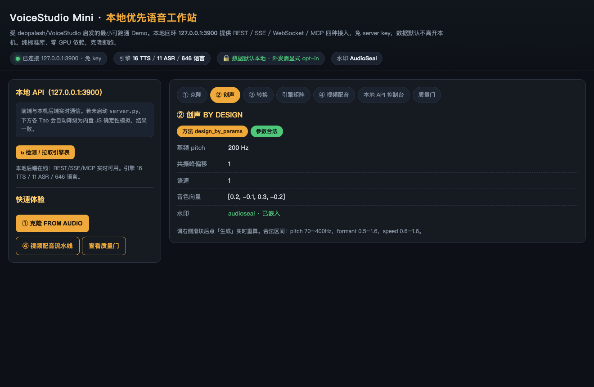
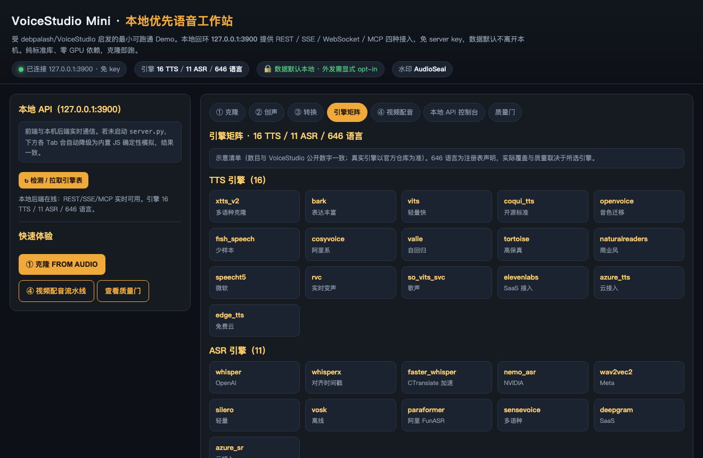
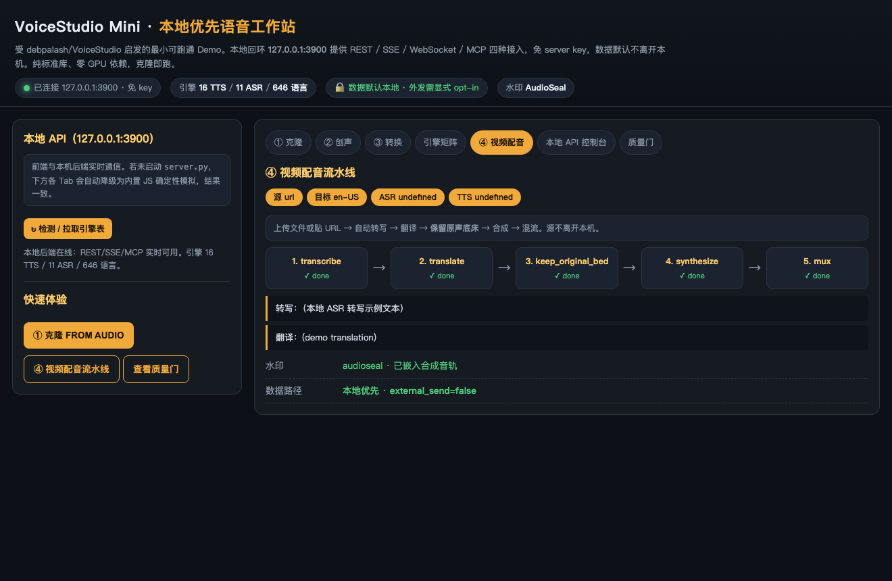
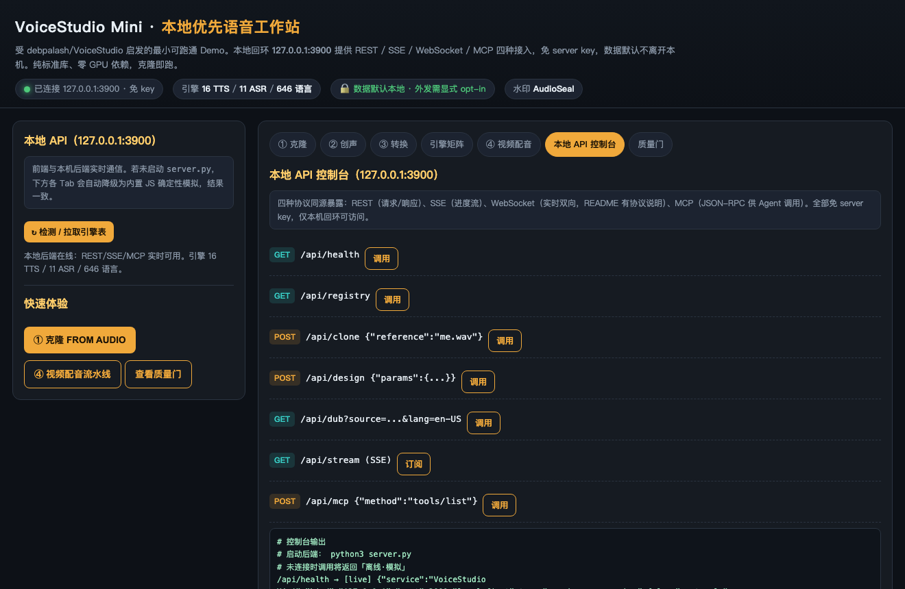
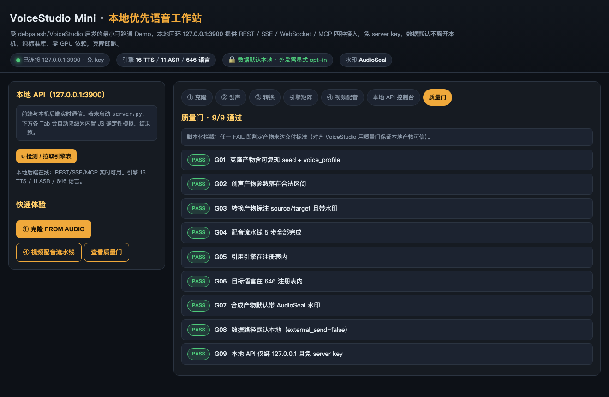

# VoiceStudio Mini · 本地优先语音工作站（最小可跑通 Demo）

> 受 [debpalash/VoiceStudio](https://github.com/debpalash/VoiceStudio) 启发的最小可跑通内核实现。
> **零 GPU、零外部依赖（纯 Python 标准库 + 原生浏览器）**，把上游「本地优先数据路径 + 三入口 + 引擎矩阵 + 视频配音流水线 + AudioSeal 水印 + 本地回环 API」复刻成一份**你真的能跑起来**的结构演示。

上游 VoiceStudio：33,744★ / AGPL-3.0 / 16 TTS · 11 ASR · 646 语言 / 无账号·无 key·无订阅 / 桌面端 Electron + 本机回环 `:3900`（REST/SSE/WebSocket/MCP）/ 默认嵌入 AudioSeal 水印。

---

## 它解决什么

云端语音按次收费、账号锁定、数据外发。VoiceStudio 把数据路径反过来：**默认本地，外发显式 opt-in**——数据不离开本机，agent 只拿到结果。本 Demo 用确定性算法 1:1 复刻这套能力结构。

## 三大入口

| 入口 | 方法 | 产物 |
|------|------|------|
| ① 克隆 FROM AUDIO | `clone_from_audio(reference)` | 可复现的音色档案（seed + pitch/formant/speed/timbre）|
| ② 创声 BY DESIGN | `design_by_params({pitch, formant, speed, timbre})` | 由显式参数合成的音色档案（含合法区间校验）|
| ③ 转换 CONVERT | `convert_voice(text, target_profile)` | 语音转语音 / 合成，标注 source/target + 水印 |

## 本地回环 API（127.0.0.1:3900，免 server key）

同源暴露四种协议，供桌面端或任意 Agent 调用：

- **REST** `GET /api/health` · `GET /api/registry` · `POST /api/clone` · `POST /api/design` · `POST /api/convert` · `GET /api/dub`
- **SSE** `GET /api/stream`（配音进度事件流）
- **WebSocket** 实时双向（见下「接入说明」）
- **MCP** `POST /api/mcp`（`tools/list` / `tools/call`，暴露 `vs_clone / vs_design / vs_convert / vs_dub / vs_registry`）

刻意只绑回环地址 == 「外发需显式 opt-in」的数据路径。

## 质量门（脚本化拦截）

9 道门覆盖：克隆可复现、创声参数合法、转换带水印、配音 5 步完成、引擎/语言在册、默认水印、本地优先、API 仅绑回环且免 key。任一 FAIL 即判定未达交付标准。

---

## 如何运行

```bash
# 1) headless 管线：落 output/*.json + 跑质量门（无需 GPU）
python3 pipeline.py

# 2) 本地 API：启动后即可被前端 / Agent 调用（127.0.0.1:3900，免 key）
python3 server.py

# 3) 浏览器打开 index.html（自动对接本地 API；断网降级为内置 JS 模拟，结果一致）
#    或用静态服务器： python3 -m http.server 8733  →  http://localhost:8733/index.html
```

> 前端 `index.html` 会检测本地 API 是否在线：在线则所有操作走真实 `:3900` 端点（控制台打 `[live]`），离线则降级为与后端同构的内置 JS 确定性模拟（打 `[模拟]`）。**两种模式结果一致。**

### 接入说明（Agent / 前端）

```bash
# REST：克隆
curl -X POST http://127.0.0.1:3900/api/clone -H 'Content-Type: application/json' \
     -d '{"reference":"me.wav","tts_engine":"xtts_v2"}'

# SSE：订阅配音进度
curl -N http://127.0.0.1:3900/api/stream

# MCP（JSON-RPC）：列出工具
curl -X POST http://127.0.0.1:3900/api/mcp -H 'Content-Type: application/json' \
     -d '{"jsonrpc":"2.0","id":1,"method":"tools/list"}'
```

WebSocket：前端可 `new WebSocket("ws://127.0.0.1:3900/ws")` 建立实时双向通道（Demo 后端以 SSE 提供同源的进度流，真实实现见上游仓库）。

---

## 项目结构

```
voicestudio-mini/
├── core.py            # 确定性内核（引擎注册表 / 克隆 / 创声 / 转换 / 配音 / 水印 / 质量门）
├── server.py          # 本地 API：127.0.0.1:3900，REST/SSE/MCP，免 server key
├── pipeline.py        # headless 管线：落 output/*.json + 跑质量门
├── index.html         # 交互式前端（三入口 + 引擎矩阵 + 配音流水线 + API 控制台 + 质量门）
├── SKILLS.md          # 技能说明（复刻上游能力结构）
├── samples/           # 示例数据说明（参考音频为示意文件名）
├── output/            # pipeline.py 生成产物（8 个 JSON）
├── assets/            # README 操作截图
└── LICENSE            # MIT（演示）；上游本体 AGPL-3.0
```

---

## 操作截图（README）

> 以下截图来自 `index.html` 真实运行，且本地 API 处于「已连接 127.0.0.1:3900 · 免 key」状态。

### ① 克隆 FROM AUDIO（默认页）


### ② 创声 BY DESIGN（滑块参数 → 生成的音色档案）


### 引擎矩阵（16 TTS / 11 ASR / 646 语言）


### ④ 视频配音流水线（5 步全部 done）


### 本地 API 控制台（REST/SSE/WS/MCP + 实时调用）


### 质量门（9/9 PASS）


---

## 说明 / 免责

- 本仓库为**结构演示**：所有声学参数由输入字符串的哈希确定性派生（同样输入永远得到同样产物），**不含真实音频编解码或声学模型**。
- 引擎清单数目与上游公开数字一致，引擎名为示意；**646 语言为注册表声明，实际覆盖与质量取决于所选引擎**。
- 正式生产请使用上游仓库：https://github.com/debpalash/VoiceStudio
  （本体 AGPL-3.0，默认权重 CC-BY-NC）。

## License

MIT（本演示仓库）· 上游 VoiceStudio 为 AGPL-3.0。
